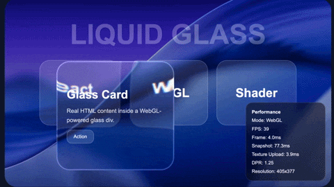
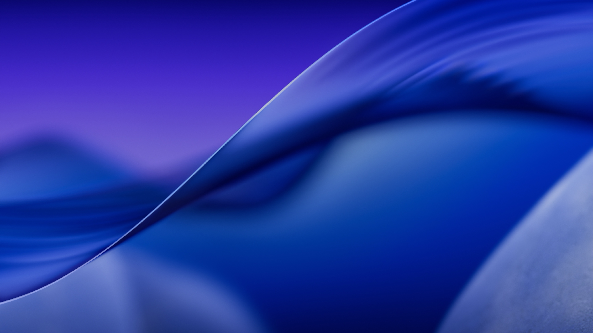

# react-webgl-liquid-glass

React components for a **liquid glass** effect rendered with WebGL2: background blur, lens distortion, zoom, chromatic aberration, frost and edge lighting. When WebGL2 is not available, it falls back to CSS `backdrop-filter` automatically.



- Real HTML inside the glass. Children render on top as normal DOM.
- TypeScript types, ESM and CommonJS builds, tree-shakeable.
- Safe for server rendering (Next.js, Remix, Astro). Nothing touches `window` until the component mounts.
- Works with React 17, 18 and 19.

## Install

```bash
npm install react-webgl-liquid-glass
# or
pnpm add react-webgl-liquid-glass
yarn add react-webgl-liquid-glass
bun add react-webgl-liquid-glass
```

## Quick start

```tsx
import { LiquidGlassContainer, GlassCard, GlassButton } from "react-webgl-liquid-glass";

export function Hero() {
  return (
    <LiquidGlassContainer style={{ height: 500 }}>
      

      <GlassCard blur={20} distortion={40} style={{ position: "absolute", top: 80, left: 80, width: 320 }}>
        <h2>Glass Card</h2>
        <p>Anything behind this card is refracted.</p>
        <GlassButton onClick={() => alert("hi")}>Action</GlassButton>
      </GlassCard>
    </LiquidGlassContainer>
  );
}
```

`<LiquidGlassContainer>` is the backdrop. Everything rendered inside it (except the glass elements themselves) is captured and bent by the glass. Without a container, a glass element uses its parent element as the backdrop.

## Components

| Component | What it is |
|-----------|------------|
| `<LiquidGlassContainer>` | A `div` that defines the captured background. Accepts `defaults` to share effect settings with every glass inside. |
| `<LiquidGlass>` | The base glass surface. Renders a `div` by default; use `as="section"`, `as="a"`, etc. for another element. |
| `<GlassCard>` | A padded glass panel (`radius` 40). |
| `<GlassButton>` | A pill-shaped glass `<button>`. |
| `useLiquidGlass()` | The hook behind `<LiquidGlass>`, for building your own glass components. |

## Effect props

All effect values are numbers from **0 to 100**, so they map directly to sliders.

| Prop | Default | Effect |
|------|---------|--------|
| `radius` | `45` | Corner radius (100 ≈ 80px, clamped to a pill on small elements) |
| `blur` | `50` | Background blur |
| `distortion` | `30` | Lens distortion near the edges |
| `zoom` | `35` | Magnification of the content under the glass |
| `chromaticAberration` | `20` | RGB split at the edges |
| `frost` | `8` | Frost noise strength |
| `frostScale` | `50` | Frost noise size |
| `light` | `30` | Specular highlight strength |
| `edgeGlow` | `40` | Rim glow |
| `edgeWidth` | `25` | Rim width |
| `tint` | `94` | Brightness (lower is darker) |
| `alpha` | `97` | Opacity of the glass |
| `lightDirection` | `[-0.7, -1]` | Highlight direction as an `[x, y]` vector |

Effect props can change at any time; they update the shader without re-capturing the page.

## Other props

| Prop | Default | Description |
|------|---------|-------------|
| `container` | nearest container, else parent | Element to capture: a ref, an element or a CSS selector. |
| `autoRefresh` | `false` | Re-capture the background when the DOM inside the container changes. |
| `maxDpr` | `1.25` | Cap on device pixel ratio (limits GPU cost). |
| `targetFps` | `30` | Maximum render rate. |
| `capture` | `html2canvas` | Custom capture function (see below). |
| `disabled` | `false` | Always use the CSS fallback. |
| `onModeChange` | | `(mode, reason?) => void`. `mode` is `"pending"`, `"webgl"` or `"fallback"`. |
| `onStats` | | Called about twice per second with `{ fps, frameTime, snapshotTime, uploadTime, dpr, width, height }`. |
| `fallbackStyle`, `fallbackClassName` | | Style the CSS fallback layer. |
| `contentStyle`, `contentClassName` | | Style the wrapper around `children`. |

All other props (`className`, `style`, event handlers, `aria-*`, `data-*`) go to the root element. The root also gets `data-liquid-glass-mode`, which you can target in CSS.

## Refreshing the background

The background is captured once, then again when the container is resized. Moving the glass only re-crops the existing capture, so dragging is cheap. When the content behind the glass changes, either pass `autoRefresh` or call `refresh()` through a ref:

```tsx
const glass = useRef<LiquidGlassHandle>(null);
// after content changes:
await glass.current?.refresh();

<LiquidGlass ref={glass} />;
```

Add `data-liquid-glass-ignore` to any element (an overlay, a tooltip) that should not appear in the captured background.

## Build your own glass component

```tsx
import { useLiquidGlass } from "react-webgl-liquid-glass";

function GlassAvatar({ src }: { src: string }) {
  const { glassRef, canvasRef, mode } = useLiquidGlass({ radius: 100, zoom: 70 });
  return (
    <div ref={glassRef} data-liquid-glass="" style={{ position: "relative", width: 96, height: 96 }}>
      <canvas ref={canvasRef} style={{ position: "absolute", inset: 0, width: "100%", height: "100%" }} />
      {mode !== "webgl" && <div style={{ position: "absolute", inset: 0, backdropFilter: "blur(8px)", borderRadius: "50%" }} />}
    </div>
  );
}
```

## Without React

The renderer is framework-agnostic and available from `react-webgl-liquid-glass/core`:

```ts
import { createLiquidGlassEngine } from "react-webgl-liquid-glass/core";

const engine = createLiquidGlassEngine({
  container: document.querySelector("#container")!,
  glass: document.querySelector("#glass")!,
  canvas: document.querySelector("#glass canvas")!,
  effect: { blur: 20 }
});

engine.setEffect({ blur: 40 });
engine.refresh();
engine.destroy();
```

## Next.js

The package's entry is marked `"use client"`, so you can import the components straight into a Server Component page. They render a CSS-fallback glass on the server and switch to WebGL after hydration.

## Limitations

- **Cross-origin images** need CORS headers (`crossorigin="anonymous"` on ``). A tainted canvas switches the glass to the CSS fallback.
- **Modern CSS colors.** `html2canvas` 1.4 can't parse `oklch()` and `color-mix()` (used by Tailwind CSS v4). Pass a capture function built on [`html2canvas-pro`](https://www.npmjs.com/package/html2canvas-pro):

  ```tsx
  import html2canvas from "html2canvas-pro";

  const capture = (el, { scale, ignoreElements }) =>
    html2canvas(el, { backgroundColor: null, scale, useCORS: true, ignoreElements });

  <LiquidGlassContainer defaults={{ capture }}>…</LiquidGlassContainer>
  ```
- **Video, iframes and canvas animations** behind the glass are captured as a still image.
- **Cost.** Capturing a large DOM can take tens to hundreds of milliseconds, and heavy blur on large glass surfaces is expensive on low-end GPUs. Lower `maxDpr`, `targetFps` or `blur` if needed.
- The CSS fallback doesn't support distortion, zoom, chromatic aberration or frost.

## Development

```bash
npm install
npm run dev        # demo at http://localhost:5173
npm test
npm run build      # outputs dist/
```

## License

MIT © Ali A. Jafari
